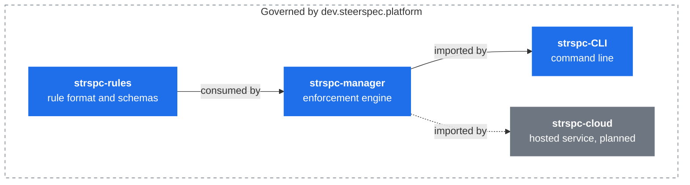
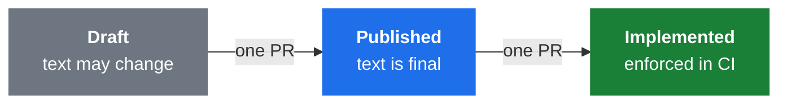

<div align="center">

# SteerSpec Platform

**The rules that span every SteerSpec repository, written as a SteerSpec realm.**

[](https://github.com/SteerSpec/strspc-spec/actions/workflows/ci.yml)
[](rules/realm.json)
[](LICENSE)

[Architecture](#architecture) · [Rules](#rules) · [Where rules live](#where-rules-live) · [Working with the rules](#working-with-the-rules) · [Releases](#branching-and-releases) · [Conventions](#conventions)

</div>

[SteerSpec](https://steerspec.dev) manages behavioral rules as structured JSON with deterministic
enforcement. This repository is the `dev.steerspec.platform` realm. It covers what no single
component can own: how the tiers depend on each other, the order they release in, and where rule
logic lives.

## Architecture



Dependencies point one way, and releases land in the same order: rules, then manager, then its
consumers.

## Rules

| ID | Topic | Rule |
| -- | ----- | ---- |
| STRSPC-001 | **Tier direction** | Dependencies point downward only: rules → manager → CLI / cloud |
| STRSPC-002 | **Release order** | Releases land upstream first, each consumer pinning a released version |
| STRSPC-003 | **Realm ownership** | Every repository that ships platform code or rules owns a realm; non-core realms depend on core |
| STRSPC-004 | **CI validation** | Every realm-owning repository's CI validates its realm and lifecycle per PR |
| STRSPC-005 | **Rule immutability** | Published and Implemented rules are never edited, only superseded |
| STRSPC-006 | **Logic placement** | Rule logic lives in strspc-manager; CLI and cloud only present its results |

These are summaries; [`rules/STRSPC.json`](rules/STRSPC.json) holds the normative text.

> [!NOTE]
> STRSPC-005 is Implemented: `strspc diff` enforces it in CI. The other five rules are Published, so
> CI doesn't enforce them yet.

## Where rules live

Each component's rules live with its code:

| Realm | Repository | Scope |
| ----- | ---------- | ----- |
| `dev.steerspec.platform` | this repository | cross-cutting platform rules |
| `dev.steerspec.core` | [strspc-rules](https://github.com/SteerSpec/strspc-rules) | rule format, entities, lifecycle, configuration |
| `dev.steerspec.manager` | [strspc-manager](https://github.com/SteerSpec/strspc-manager) | enforcement engine modules and Go conventions |
| `dev.steerspec.cli` | [strspc-CLI](https://github.com/SteerSpec/strspc-CLI) | commands, configuration, conventions |
| `dev.steerspec.sync` | [strspc-sync](https://github.com/SteerSpec/strspc-sync) | configuration sync tool and actions |

## Layout

```text
strspc-spec/
├── rules/
│   ├── realm.json      # dev.steerspec.platform, depends on dev.steerspec.core@1.12.0
│   ├── STRSPC.json     # the STRSPC entity
│   └── _schema/        # schemas from steerspec.dev
├── .strspc/
│   └── config.yaml     # strspc check configuration
├── CLAUDE.md
└── LICENSE
```

## Working with the rules

Install the [`strspc` CLI](https://github.com/SteerSpec/strspc-CLI):

```bash
brew install --cask SteerSpec/tap/strspc
```

Edit entity files only through it, so versions and hashes stay consistent:

```bash
strspc rule add STRSPC --dir rules --body "..." --added-by @you
strspc rule promote STRSPC-001 --dir rules
```

Run the same validation as CI before opening a pull request:

```bash
strspc realm validate rules --recursive --strict
strspc lint rules --strict
strspc diff rules --base origin/develop
strspc check --static-only
```

CI runs these through the reusable workflows in
[SteerSpec/.github](https://github.com/SteerSpec/.github). `strspc realm validate` compares the realm
with its pinned dependencies; only `strspc check` verifies cross-realm references such as `inherits`
and `overrides`.

## Branching and releases

`develop` is the default branch and collects the changes for the next release; `main` only moves
when a release is prepared:

1. Pull requests target `develop` and are squashed, so the title becomes the commit release-please
   reads.
2. A `chore: promote develop to main` pull request carries the bundle to `main`. Merge it with a
   **merge commit**: release-please reads the individual commits, and a squash would hide them.
3. [release-please](https://github.com/googleapis/release-please) opens a release pull request
   against `main` that sets `realm.version` and updates `CHANGELOG.md`.
4. Merging it tags `v<realm.version>` and publishes a GitHub release with the rules as archives.

Title types set the version, so rule changes need the right one:

| Change | Title | Version |
| ------ | ----- | ------- |
| Add or promote a rule | `feat(rules): ...` | minor |
| Correct a Draft rule | `fix(rules): ...` | patch |
| Breaking change | `feat(rules)!: ...` | major |
| Docs, CI, chores, core pins | `docs:`, `ci:`, `chore:` | no release |

`main` holds the released `realm.version`. `develop` is not back-merged, so its copy stays behind.

Release pull requests skip the `strspc diff` lifecycle check: they aggregate transitions that were
validated one pull request at a time on the way into `develop`.

## Conventions

Rules move one state per pull request. Published and Implemented rules are never edited, they are
superseded.



| Topic | Convention |
| ----- | ---------- |
| **Commits** | [Conventional Commits](https://www.conventionalcommits.org/), as `type(scope): subject`. CI checks pull request titles |
| **Versions** | `realm.version` in `rules/realm.json` is the specification version, in [SemVer](https://semver.org/) form. release-please sets it, and `v<realm.version>` is the release tag |
| **Dependencies** | The core realm is pinned to one exact released version |

## Contributing

See the [SteerSpec contributing guide](https://github.com/SteerSpec/.github/blob/main/CONTRIBUTING.md).

## License

Apache 2.0, see [LICENSE](LICENSE).
