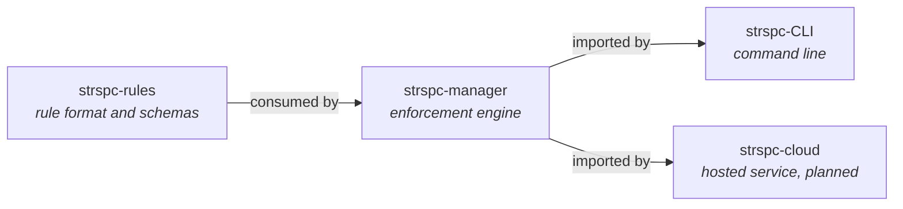

# SteerSpec Platform

> The rules that span every SteerSpec repository, written as a SteerSpec realm.

[](https://github.com/SteerSpec/strspc-spec/actions/workflows/ci.yml)
[](LICENSE)

[SteerSpec](https://steerspec.dev) manages behavioral rules as structured JSON with deterministic
enforcement. This repository is the `dev.steerspec.platform` realm. It covers what no single
component can own: how the tiers depend on each other, the order they release in, and where rule
logic lives.

## Architecture



Dependencies point one way, and releases land in the same order: rules, then manager, then its
consumers.

## Rules

| Rule | Statement |
| ---- | --------- |
| STRSPC-001 | Dependencies point downward only: rules → manager → CLI / cloud |
| STRSPC-002 | Releases land upstream first, each consumer pinning a released version |
| STRSPC-003 | Every repository owns a realm; non-core realms depend on core |
| STRSPC-004 | Every repository's CI validates its realm and lifecycle per PR |
| STRSPC-005 | Published and Implemented rules are never edited, only superseded |
| STRSPC-006 | Rule logic lives in strspc-manager; CLI and cloud only present its results |

These are summaries; [`rules/STRSPC.json`](rules/STRSPC.json) holds the normative text.

All six rules are Draft. CI fails only on Implemented rules, so none of them is enforced yet.

## Where rules live

Each component's rules live with its code:

| Realm | Repository | Scope |
| ----- | ---------- | ----- |
| `dev.steerspec.platform` | this repository | cross-cutting platform rules |
| `dev.steerspec.core` | [strspc-rules](https://github.com/SteerSpec/strspc-rules) | rule format, entities, lifecycle, configuration |
| `dev.steerspec.manager` | [strspc-manager](https://github.com/SteerSpec/strspc-manager) | enforcement engine modules and Go conventions |
| `dev.steerspec.cli` | [strspc-CLI](https://github.com/SteerSpec/strspc-CLI) | commands, configuration, conventions |
| `dev.steerspec.sync` | [strspc-sync](https://github.com/SteerSpec/strspc-sync) | configuration sync tool and actions |

## Layout

```text
strspc-spec/
├── rules/
│   ├── realm.json      # dev.steerspec.platform, depends on dev.steerspec.core@1.11.0
│   ├── STRSPC.json     # the STRSPC entity
│   └── _schema/        # schemas from steerspec.dev
├── .strspc/
│   └── config.yaml     # strspc check configuration
├── CLAUDE.md
└── LICENSE
```

## Working with the rules

Install the [`strspc` CLI](https://github.com/SteerSpec/strspc-CLI), then edit entity files only
through it, so versions and hashes stay consistent:

```bash
brew install --cask SteerSpec/tap/strspc

strspc rule add STRSPC --dir rules --body "..." --added-by @you
strspc rule promote STRSPC-001 --dir rules
```

Run the same validation as CI before opening a pull request:

```bash
strspc realm validate rules --recursive --strict
strspc lint rules --strict
strspc diff rules --base origin/main
strspc check --static-only
```

CI runs these through the reusable workflows in
[SteerSpec/.github](https://github.com/SteerSpec/.github). Only `strspc check` resolves the realm's
dependencies and verifies cross-realm references.

## Conventions

- **Rule lifecycle:** rules move Draft → Published → Implemented, one step per pull request.
  Published and Implemented rules are never edited, they are superseded.
- **Commits:** [Conventional Commits](https://www.conventionalcommits.org/), as
  `type(scope): subject`.
- **Versions:** `realm.version` in `rules/realm.json` is the specification version, in
  [SemVer](https://semver.org/) `MAJOR.MINOR.PATCH` form. This repository has no tags or releases.
- **Dependencies:** the core realm is pinned to one exact released version.

## Contributing

See the [SteerSpec contributing guide](https://github.com/SteerSpec/.github/blob/main/CONTRIBUTING.md).

## License

Apache 2.0, see [LICENSE](LICENSE).
