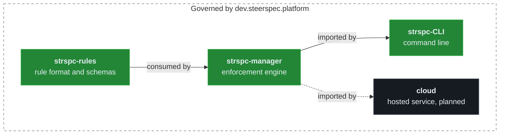

# Architecture and where rules live

[Back to the README](../README.md)

Dependencies point one way, and releases land in the same order: rules, then manager, then its
consumers.

## Where rules live

Each component's rules live with its code:

| Realm | Repository | Scope |
| ----- | ---------- | ----- |
| `dev.steerspec.platform` | this repository | cross-cutting platform rules |
| `dev.steerspec.core` | [strspc-rules](https://github.com/SteerSpec/strspc-rules) | rule format, entities, lifecycle, configuration |
| `dev.steerspec.manager` | [strspc-manager](https://github.com/SteerSpec/strspc-manager) | enforcement engine modules and Go conventions |
| `dev.steerspec.cli` | [strspc-CLI](https://github.com/SteerSpec/strspc-CLI) | commands, configuration, conventions |
| `dev.steerspec.sync` | [strspc-sync](https://github.com/SteerSpec/strspc-sync) | configuration sync tool and actions |
| `dev.steerspec.prreview` | [strspc-pr-review](https://github.com/SteerSpec/strspc-pr-review) | automated pull request approval |
| `dev.steerspec.cloud` | not yet public | hosted service, planned |
