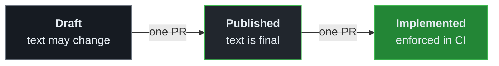

# Conventions

[Back to the README](../README.md)

Rules move one state per pull request. Published and Implemented rules are never edited, they are
superseded.

A rule can also leave this path: a dropped Draft becomes Abandoned, a rule that must be removed is
Retired, and one no longer in force is Terminated.

| Topic | Convention |
| ----- | ---------- |
| **Commits** | [Conventional Commits](https://www.conventionalcommits.org/), as `type(scope): subject`. CI checks pull request titles |
| **Versions** | `realm.version` in `rules/realm.json` is the specification version, in [SemVer](https://semver.org/) form. release-please sets it, and `v<realm.version>` is the release tag |
| **Dependencies** | The core realm is pinned to one exact released version |
